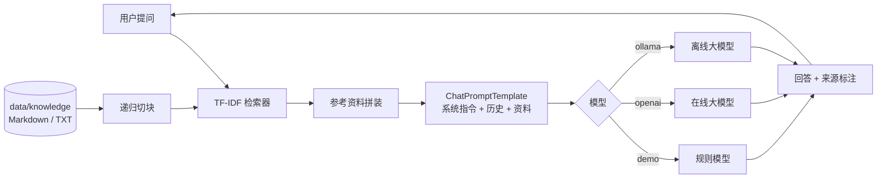

# 🦜 开源小答 · 课程知识库智能问答助手

> 《开源软件》课程第七章「智能应用开发」期末作业
> 基于 **LangChain** 框架与 **检索增强生成（RAG）** 的智能问答应用，支持**在线大模型**、**本地离线大模型**与**无网络演示**三种运行模式。


**开源仓库**：<https://github.com/Yanghanrui666/->

---

## 1. 项目简介

「开源小答」是一款面向课程学习的智能问答助手。它把课程资料（开源许可证、Git 协作流程、LangChain、RAG 等）作为本地知识库，
用户提问时先检索相关片段，再交由大模型基于这些片段生成回答，并附上**来源引用**，从而缓解大模型的"幻觉"问题。

应用的三个设计目标：

1. **可复现**：克隆仓库后无需任何 API Key 即可跑通全流程（演示模式）。
2. **可切换**：同一套代码支持在线模型、离线模型与本地规则模型，只改一个环境变量。
3. **可解释**：每个回答都带检索来源与片段编号，便于人工核对。

## 2. 功能特性

| 功能 | 说明 |
| --- | --- |
| RAG 问答 | 文档加载 → 递归切块 → TF-IDF 检索 → 提示词拼装 → 大模型生成 → 来源溯源 |
| 三种模型模式 | `demo`（离线规则模型）/ `openai`（任意 OpenAI 兼容接口）/ `ollama`（本地离线模型） |
| 双检索后端 | 默认零依赖 TF-IDF（中文单字 + 二元组切分）；可切换向量检索 |
| 多轮对话 | 历史消息通过 `MessagesPlaceholder` 注入提示词，支持上下文追问 |
| Web 界面 | Streamlit 聊天界面，参数实时可调，命中片段可展开查看 |
| 命令行 | 单轮提问与交互式会话，适合脚本化与快速验证 |
| 可测试 | 演示模型使端到端链路可在无网络环境下被 pytest 覆盖 |

## 3. 快速开始

### 3.1 环境要求

- Python 3.10 及以上（已在 3.12 验证）
- 无需 GPU；`demo` 模式完全离线

### 3.2 安装

```bash
git clone https://github.com/Yanghanrui666/-.git smartqa
cd smartqa

python -m venv .venv
# Windows
.venv\Scripts\activate
# macOS / Linux
source .venv/bin/activate

pip install -r requirements.txt
```

或作为包安装（提供 `smartqa` 命令）：

```bash
pip install -e .
```

### 3.3 配置

```bash
cp .env.example .env
```

默认配置为**演示模式**，无需任何密钥即可启动。三种模式的配置如下：

<details>
<summary><b>演示模式（默认，无需网络）</b></summary>

```ini
SMARTQA_PROVIDER=demo
```

使用内置的规则模型从检索结果中抽取句子拼装回答，用于验证"检索 → 提示词 → 解析"整条链路。
</details>

<details>
<summary><b>在线大模型（以 DeepSeek 为例）</b></summary>

```ini
SMARTQA_PROVIDER=openai
SMARTQA_MODEL=deepseek-chat
SMARTQA_BASE_URL=https://api.deepseek.com/v1
SMARTQA_API_KEY=sk-xxxxxxxxxxxxxxxx
```

任何 OpenAI 兼容接口都可用，只需替换 `SMARTQA_BASE_URL` 与 `SMARTQA_MODEL`：

| 厂商 | BASE_URL | 模型示例 |
| --- | --- | --- |
| DeepSeek | `https://api.deepseek.com/v1` | `deepseek-chat` |
| 通义千问 | `https://dashscope.aliyuncs.com/compatible-mode/v1` | `qwen-plus` |
| 月之暗面 | `https://api.moonshot.cn/v1` | `moonshot-v1-8k` |
| 智谱 | `https://open.bigmodel.cn/api/paas/v4` | `glm-4-flash` |
| OpenAI | `https://api.openai.com/v1` | `gpt-4o-mini` |
</details>

<details>
<summary><b>本地离线大模型（Ollama）</b></summary>

```bash
# 1. 安装 Ollama 并拉取模型
ollama pull qwen2.5:7b

# 2. 配置
```

```ini
SMARTQA_PROVIDER=ollama
SMARTQA_MODEL=qwen2.5:7b
SMARTQA_BASE_URL=http://localhost:11434
```

离线模式不产生任何网络请求，适合无外网的考试环境或隐私敏感场景。
</details>

### 3.4 运行

```bash
# Web 界面
streamlit run app.py

# 命令行单轮问答
python -m smartqa.cli -q "GPL 和 MIT 许可证有什么区别？"

# 交互式多轮会话
python -m smartqa.cli -i --show-sources
```

浏览器打开终端提示的地址（默认 <http://localhost:8501>），即可开始对话。

## 4. 使用示例

```
你 > 提交代码前为什么不能提交 API Key？

开源小答：
（演示模式回答）关于「提交代码前为什么不能提交 API Key？」……

- 切勿提交任何 API Key、令牌或私钥；一旦提交，即使后续删除，历史记录中仍然存在，需要立即吊销并轮换密钥。
- `.gitignore` 用于排除虚拟环境、缓存、日志与 `.env` 等本地文件。

--- 参考来源 ---
  · 02-Git与协作流程.md #3
```

在 Web 界面中，每个回答下方都有「📚 参考资料」折叠面板，可直接查看命中的原文片段与来源编号。

## 5. 系统架构



核心问答链用 LCEL 表达（`src/smartqa/chain.py`）：

```python
chain = (
    RunnablePassthrough.assign(documents=retrieve)
    | RunnablePassthrough.assign(context=format_documents)
    | RunnablePassthrough.assign(answer=prompt | llm | StrOutputParser())
    | RunnableLambda(lambda x: Answer(text=x["answer"], sources=x["documents"]))
)
```

更多设计说明见 [docs/architecture.md](docs/architecture.md)。

## 6. 目录结构

```
.
├── app.py                     # Streamlit Web 界面
├── src/smartqa/
│   ├── __init__.py            # 公开 API
│   ├── config.py              # .env 配置解析
│   ├── llm.py                 # 三种模型接入 + 演示模型
│   ├── retriever.py           # 文档加载、切块、TF-IDF / 向量检索
│   ├── chain.py               # 提示词与 LCEL 问答链
│   └── cli.py                 # 命令行入口
├── data/knowledge/            # 知识库（4 篇课程资料）
├── tests/                     # pytest 单元与端到端测试
├── docs/
│   ├── architecture.md        # 架构说明
│   ├── 开源小答-README文档说明.docx   # 可直接提交的 Word 版文档说明
│   └── assets/architecture.png       # 架构图
├── scripts/                   # 文档与配图生成脚本
├── requirements.txt           # 运行依赖
├── requirements-dev.txt       # 开发依赖
├── pyproject.toml             # 包元数据与 pytest 配置
├── .env.example               # 配置模板
└── LICENSE                    # MIT
```

## 7. 测试

```bash
pip install -r requirements-dev.txt
pytest
```

测试全部使用演示模型，不依赖网络与 API Key，覆盖：

- 中文分词（单字 + 二元组）、文档加载、切块元数据
- TF-IDF 排序正确性、空知识库与无词面重叠的兜底行为
- 端到端问答：回答非空、来源可溯源、多轮历史注入、空问题校验
- 配置解析：默认值、环境变量覆盖、非法值回落

## 8. 常见问题

**Q：启动报 `API Key` 相关错误？**
在线模式必须设置 `SMARTQA_API_KEY`；如果只是想先看看效果，把 `SMARTQA_PROVIDER` 改回 `demo`。

**Q：Ollama 连接失败？**
确认 `ollama serve` 已在运行，且 `SMARTQA_BASE_URL` 与实际端口一致（默认 11434），模型已用 `ollama pull` 拉取。

**Q：回答里说"资料中没有找到相关内容"？**
说明检索没有命中。可以把问题换成文档里的术语，或增加 `SMARTQA_TOP_K`，或向 `data/knowledge` 补充资料。

**Q：如何换成自己的知识库？**
把 Markdown / TXT 文件放进 `data/knowledge`（或修改 `SMARTQA_KNOWLEDGE_DIR`），界面会自动重新索引。

**Q：为什么默认不用向量检索？**
为了"克隆即可运行"。开启 `SMARTQA_USE_EMBEDDINGS=true` 并提供 API Key 后，会改用 `InMemoryVectorStore` + embedding 接口。

## 9. 后续可扩展方向

- 支持 PDF / DOCX / 网页加载与 OCR
- 接入重排模型（rerank）与混合检索
- 用 LangGraph 做多步推理与工具调用（如查询许可证兼容性矩阵）
- 增加评估集与自动化回归（召回率、忠实度）
- 提供 FastAPI 服务化接口

## 10. 许可证

本项目采用 [MIT License](LICENSE) 开源，可自由用于学习、修改与再分发。

## 11. 致谢

- [LangChain](https://github.com/langchain-ai/langchain) — 应用编排框架
- [Streamlit](https://github.com/streamlit/streamlit) — Web 界面
- [Ollama](https://github.com/ollama/ollama) — 本地模型运行时
